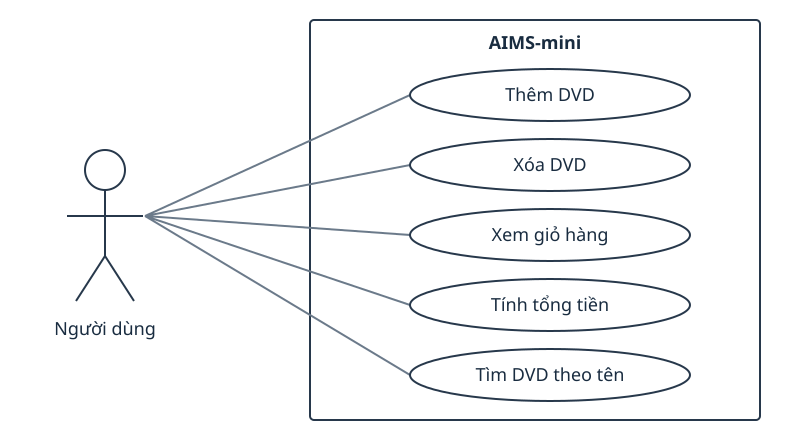

# AIMS-mini use cases

The user adds and removes DVDs, views the cart, calculates the total,
and searches by title. main.py demonstrates a fixed example; it does
not provide an interactive menu.

| Use case | Result |
|---|---|
| Add DVD | Accept a disc while the cart has space |
| Remove DVD | Remove a disc already in the cart |
| View cart | Print DVD details or an empty-cart message |
| Calculate total | Sum the costs of the DVDs in the cart |
| Search by title | Return titles containing the search substring |

The supplied SVG is reused as a diagram of these same application
operations. It contains an actor, use-case ellipses and a system boundary.
